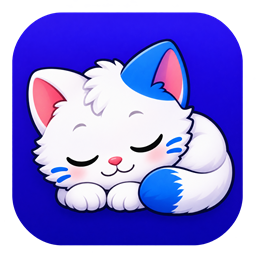

<p align="center">
  
</p>

# Happy Okky

[한국어](README.md) · English

Happy Okky brings **Okky**, the cat mascot of [OKKY](https://okky.kr), to Windows as a desktop pet. Okky strolls above the taskbar, plays fetch, and curls up to sleep when things get quiet.

## Download and run

The app runs on Windows 10 or 11 (x64). Download the Windows ZIP from [GitHub Releases](https://github.com/jay94ks/happyokky/releases/latest), extract it, and open `happy-okky.exe`.

## Spend time with Okky

| Action | Control |
| --- | --- |
| Open the status panel | Click Okky while awake. |
| Change the name | Double-click the name in the status panel. Enter up to 24 characters, then press Enter to save or Esc to cancel. |
| Feed or pet | Use the bowl or heart button. The cooldowns are 60 seconds for feeding and 10 seconds for petting. |
| Play fetch | Tap the ball button for a short throw. Hold it for up to one second to throw farther. The cooldown is 30 seconds. |
| Pick up and move | Drag Okky and release to land by that monitor's taskbar. If the monitor has no taskbar, Okky returns to the primary monitor. |
| Put to sleep or wake up | Right-click Okky or the notification-area icon and select **재우기** (Sleep). Click three times to wake Okky from deep sleep. |
| Quit | Select **종료** (Quit) from the same right-click menu. |

The status panel follows Okky and uses the Windows light or dark theme. Close it with the close button or Esc when you are outside the name editor.

Okky rests or walks depending on fullness and mood. The head and body turn through 15-degree poses when changing direction. A relaxed Okky may sit and knead on the taskbar, or turn away and knead while standing when the desktop is visible. Okky starts dozing after five minutes without mouse movement and falls into deep sleep at six minutes.

## Saved data and input

Fullness, mood, and the cat's name are stored in `%LOCALAPPDATA%\NyangArchi\pet.txt`. Happy Okky uses the same save location as NyangArchi. If that file is missing, it checks for an older OKKY Tamagotchi save.

Walking and fast typing make Okky hungry faster. The app uses Windows Raw Input to count key presses in memory. It does not store or transmit typed text or keystroke logs.

## Build from source

Install Rust for the MSVC target and the Visual Studio C++ build tools on Windows. See `Cargo.toml` for the minimum Rust version. Run these commands in PowerShell from the repository root.

```powershell
cargo build --release --locked
.\target\release\happy-okky.exe
```

## Development

- [AGENTS.md](AGENTS.md) describes the code structure and project conventions.
- [Adding features with an AI agent](docs/AI_AGENT_GUIDE.md) includes a sample request and verification steps.
- See [LICENSE](LICENSE) for the repository license.

 [Windows icon file](assets/happy-okky.ico)
