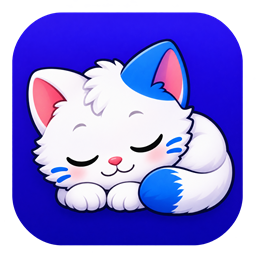

<p align="center">
  
</p>

# 행복한 옥키

한국어 · [English](README.en.md)

[OKKY](https://okky.kr)의 고양이 마스코트 **옥키(Okky)**를 Windows 데스크톱 펫으로 만든 앱입니다. 옥키는 작업 표시줄 위를 산책하고, 공을 물고 돌아오고, 한동안 조용하면 몸을 웅크려 잠듭니다.

## 다운로드와 실행

Windows 10/11 x64에서 실행할 수 있습니다. [GitHub Releases](https://github.com/jay94ks/happyokky/releases/latest)에서 Windows ZIP을 받은 뒤 압축을 풀고 `happy-okky.exe`를 실행하세요.

## 옥키와 지내기

| 동작 | 조작 |
| --- | --- |
| 상태창 열기 | 깨어 있는 옥키를 클릭합니다. |
| 이름 바꾸기 | 상태창의 이름을 더블클릭합니다. 최대 24자까지 입력할 수 있고, Enter로 저장하거나 Esc로 취소합니다. |
| 밥 주기와 쓰다듬기 | 상태창의 밥그릇과 하트 버튼을 누릅니다. 다시 사용하기까지 각각 60초, 10초가 걸립니다. |
| 공 던지기 | 공 버튼을 짧게 누르면 가까이 던집니다. 최대 1초 동안 길게 누르면 더 멀리 던집니다. 다시 사용하기까지 30초가 걸립니다. |
| 옮기기 | 옥키를 누른 채 끌고 놓습니다. 놓은 모니터의 작업 표시줄에 착지하며, 그곳에 작업 표시줄이 없으면 기본 모니터로 돌아갑니다. |
| 재우기와 깨우기 | 옥키나 알림 영역 아이콘을 우클릭해 **재우기**를 선택합니다. 깊이 잠든 옥키는 세 번 클릭하면 깨어납니다. |
| 종료 | 같은 우클릭 메뉴에서 **종료**를 선택합니다. |

상태창은 옥키를 따라다니고 Windows의 밝은 테마와 어두운 테마를 따릅니다. 이름 편집 중이 아닐 때는 Esc나 닫기 버튼으로 상태창을 닫을 수 있습니다.

옥키는 포만감과 기분에 따라 쉬거나 산책합니다. 걷는 방향을 바꿀 때 고개와 몸통이 15도 단위로 돌아갑니다. 편안하면 작업 표시줄에서 앉아 꾹꾹이하고, 바탕 화면이 보일 때는 가끔 등을 보인 채 서서 꾹꾹이합니다. 마우스를 5분 움직이지 않으면 졸고, 6분이 되면 깊이 잠듭니다.

## 저장 데이터와 입력

포만감, 기분, 이름은 `%LOCALAPPDATA%\NyangArchi\pet.txt`에 저장됩니다. 이전 냥아치의 저장 위치를 그대로 사용하며, 해당 파일이 없으면 이전 OKKY 다마고치 저장을 읽습니다.

옥키가 많이 걷거나 타이핑이 빠르면 포만감이 더 빨리 줄어듭니다. 앱은 Windows Raw Input으로 키를 누르는 속도를 메모리에서 집계합니다. 입력한 텍스트나 키 기록을 파일에 저장하거나 전송하지 않습니다.

## 소스에서 빌드

Windows에서 MSVC 대상 Rust와 Visual Studio C++ 빌드 도구를 설치한 뒤, 저장소 루트의 PowerShell에서 실행합니다. Rust 최소 버전은 `Cargo.toml`을 참고하세요.

```powershell
cargo build --release --locked
.\target\release\happy-okky.exe
```

## 개발

- [AGENTS.md](AGENTS.md)에는 코드 구조와 변경·검증 규칙이 있습니다.
- [AI Agent로 기능 추가하기](docs/AI_AGENT_GUIDE.md)에는 요청 예시와 검증 방법이 있습니다.
- [LICENSE](LICENSE)에서 저장소의 라이선스를 확인할 수 있습니다.

 [Windows 아이콘 파일](assets/happy-okky.ico)
